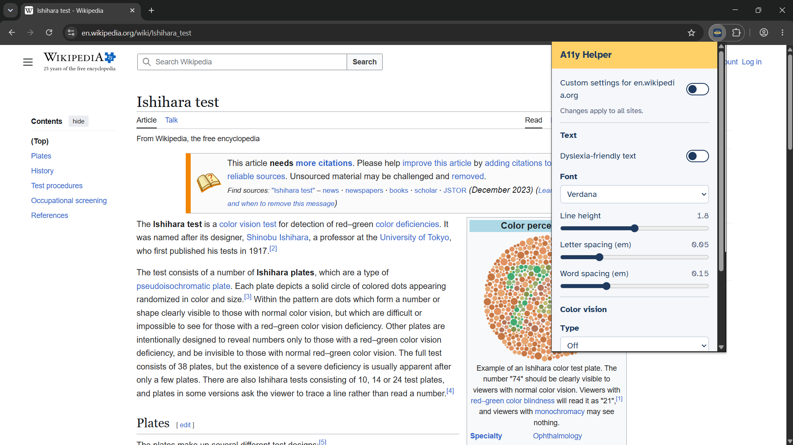
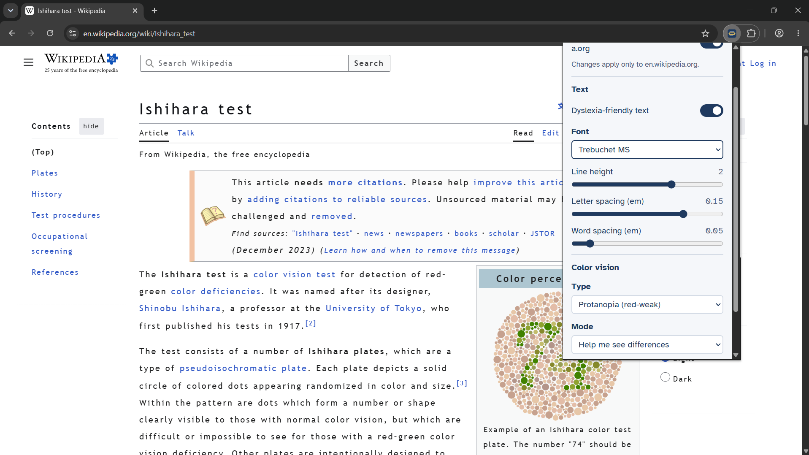

# A11y Helper

A browser extension that makes web pages easier to read for people with dyslexia, color blindness, or trouble keeping their place in a line of text.

## The problem

Most websites are designed for one kind of reader. Tight line spacing, low-variety typography, and color-coded information make pages hard to read for many people, and most sites give no way to adjust them. A11y Helper lets you change how any page looks without waiting for the site to fix it.

## Features

- Dyslexia-friendly text: choose a font and adjust line height, letter spacing, and word spacing. Icons and code blocks are left alone.
- Color vision support: filters for protanopia, deuteranopia, and tritanopia, with two modes: *Help me see differences* (shifts confusable colors apart) and *Simulate* (shows what a color-blind person sees, useful for testing designs).
- Reading ruler: a highlighted band follows your mouse and dims the rest of the page. Height and dimming are adjustable.
- Per-site settings: keep one set of defaults for all sites, and give any site its own settings.

## Demo

| Original | Deuteranopia simulation |
|---|---|
|  |  |


## Install (development)

Requires Node 20 or newer.

```bash
git clone https://github.com/YOUR-USERNAME/a11y-helper.git
cd a11y-helper
npm install
npm run dev
```

`npm run dev` opens Chrome with the extension loaded and reloads it when you change code.

To load a production build manually:

```bash
npm run build
```

Then open `chrome://extensions`, turn on **Developer mode**, click **Load unpacked**, and select `.output/chrome-mv3`.

## How it works

- Content script applies settings to each page by injecting a stylesheet, an SVG color filter, and the ruler element.
- Color filters use `feColorMatrix` with published color-vision matrices. The correction mode adds back the color information a viewer is missing, redirected into channels they can tell apart.
- Settings are stored in `chrome.storage.sync`: one `global` key plus one `site:<hostname>` key per customized site, which keeps each item well within the per-item storage limit.

## Tech stack

WXT (Manifest V3), React, TypeScript, Tailwind CSS.

## Known limitations

- Icon detection for the text feature is heuristic, so some sites may still show odd icons.
- Subdomains are treated as separate sites (`en.wikipedia.org` and `www.wikipedia.org`).
- Color correction is an approximation. Color vision varies between people.
- Text size is not adjustable yet, because many sites use fixed pixel sizes.

## Roadmap

- Text-to-speech for selected text
- Keyboard shortcuts
- Reader mode

## License

MIT